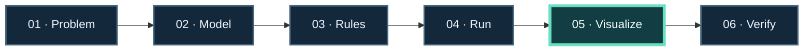

<!-- The Singularity Workshop moniker -->

  

# ✳️ 00 — Learn The Singularity Workshop

**Start with a problem. Learn the model. See the result. Check that it works.**

A practical learning center for building with The Singularity Workshop. The guides are organized around problems to solve and workflows to follow; linked project repositories hold the deeper API, setup, and implementation references.

🧭 **[Open the interactive learning explorer →](https://trentbest.github.io/TheSingularityWorkshop.Learning/)** — choose a plan by the application you want to build or the Workshop technology you want to learn. Each path has its own guided page and deeper project links.

## Choose a targeted learning plan

Start with the job you want to do, then follow the relevant Workshop technology. The [plan catalog](docs/plans/INDEX.md) groups six application missions and seven technology routes; each opens a focused learning page with progression steps and checkpoints.

## A problem made visible

*GUI.SVG turns a scene model into a vector image. This animated fox-and-sheepdog scene is illustrative choreography; it is not driven by a live FSM_API execution trace. The [worked oscillator lesson](docs/PROBLEM_TO_PROOF.md) shows an evidence-backed path from actual state changes to a rendered snapshot.*

## Learn by solving

Each lesson should help you answer: What problem are we solving? What changes? Which Workshop project owns each part? What result should I expect? What does that result actually prove?

Follow the course-level [Learning Journey](docs/LEARNING_JOURNEY.md) to see how the worked problems build from a visible scene toward capability, data, and host boundaries.

The progression diagram is an authored teaching framework, not a project architecture or runtime trace.

## Featured lesson: state that stays within bounds

See how a finite state machine keeps a value between endpoints, reverses direction at each boundary, records the result, and passes the final state to GUI.SVG for a picture.

[**Follow the worked problem from model to proof →**](docs/PROBLEM_TO_PROOF.md)

The source recipe is [FSM-driven bounded oscillator](https://github.com/TrentBest/TheSingularityWorkshop.GUI/blob/development/samples/demonstrations/recipes/07-fsm-driven-oscillator.md). Its CI run and generated artifacts are [here](https://github.com/TrentBest/TheSingularityWorkshop.GUI/actions/runs/40961583029).

## Choose your next problem

- **Model changing behavior:** [Control behavior with state machines](docs/LEARNING_PATHS.md#control-behavior-with-state-machines)
- **Assemble reusable capabilities:** [Compose capabilities into a runtime](docs/LEARNING_PATHS.md#compose-capabilities-into-a-runtime)
- **Describe and send requests:** [Follow the REST operation walkthrough](docs/REST_CAPABILITY.md)
- **Turn recorded results into a picture:** [Follow a Physics run record into GUI.SVG](docs/TRACE_TO_TRAJECTORY.md)
- **Debug an unexpected result:** [Find the first mismatch across a workflow](docs/DEBUG_A_RESULT.md)
- **Create something people can experience:** [Author and present an Experience](docs/LEARNING_PATHS.md#author-and-present-an-experience)
- **Make meaning and interaction visible:** [Model, render, and interact](docs/LEARNING_PATHS.md#model-render-and-interact)
- **Browse visual problem examples:** [Visual Lab](docs/VISUAL_LAB.md)
- **Explore the project landscape:** [Functional Map](docs/FUNCTIONAL_MAP.md)

## How to use this center

1. Start with a goal or challenge, not a repository name.
2. Follow one lesson from input/problem through model, execution, visible result, and checks.
3. Change a parameter and predict what should change.
4. Use the linked project docs for exact setup, APIs, security, limitations, and current implementation status.

The learning pages are the guide; the linked repositories remain the authority for implementation. Code and diagrams are labeled as verified, source-checked, or conceptual so you can see the evidence behind each claim.

## 🟪 Learning center guides

- [Start Here](docs/START_HERE.md)
- [Learning Journey](docs/LEARNING_JOURNEY.md)
- [Problem to Proof](docs/PROBLEM_TO_PROOF.md)
- [Run Record to Trajectory Picture](docs/TRACE_TO_TRAJECTORY.md)
- [Debug a Result](docs/DEBUG_A_RESULT.md)
- [REST Capability](docs/REST_CAPABILITY.md)
- [Visual Lab](docs/VISUAL_LAB.md)
- [Learning Paths](docs/LEARNING_PATHS.md)
- [Functional Map](docs/FUNCTIONAL_MAP.md)
- [Shared Vocabulary](docs/GLOSSARY.md)
- [Editorial Standard](docs/EDITORIAL_STANDARD.md)

---

## 🔗 Project links

- [Workshop public repositories](https://github.com/TrentBest?tab=repositories)
- [FSM_COS documentation standard](https://github.com/TrentBest/TheSingularityWorkshop.FSM_COS/blob/master/DOCUMENTATION_STANDARD.md)
