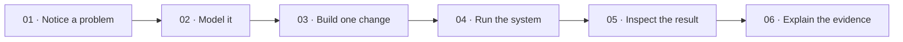

<!-- The Singularity Workshop moniker -->

# ✳️ Singularity University

**Learn the Workshop by living in the problem.**

The Learning Center is a browser-based university prototype set inside the vision of Singularity City. Enter a full-screen, first-person campus. Walk its low-poly quad, find a workshop door, inspect a course, and enroll without leaving the scene.

🧭 **[Enter Singularity University →](https://trentbest.github.io/TheSingularityWorkshop.Learning/)**

## Start with a problem

Each course asks you to do something concrete: give meaning to a click, build a scene from a model, compose a capability, hear a reflected path, design a learner activity, or diagnose a mismatch. Course cards point to the relevant Workshop repositories and current learning guides for deeper reading.

Campus movement and learning actions are routed through FSM_UserIO `SemanticIntent`s. Enrollment is held for this browser session; it does not create a persistent student account.

## A living campus, with clear evidence

The Pages build checks out WebPage and generates city/campus references from its actual catalogs. In the first-person experience, the Blazor host submits VisualizerFrames through Visualize's Visualizer.RenderAsync API to a browser WebGPU backend. It uploads the indexed campus mesh by resource revision and redraws it with a perspective camera and depth testing as the learner moves. The city catalog marks University Quarter as future, so the campus remains a learning prototype based on source-backed places, not a claim that Singularity City is fully composed. For the GPU backend's data flow, verified scope, and current limitations, see the [Campus WebGPU proof](docs/CAMPUS_GPU_RENDERER.md) and [University experience notes](docs/SINGULARITY_UNIVERSITY.md).

## Learn by solving

This is the learning progression used by the center, not a claim about the architecture of a Workshop runtime.

## Enter a real lab

🧪 **[Launch the FSM_API + FSM_UserIO Behavior Lab →](https://trentbest.github.io/TheSingularityWorkshop.Learning/demo/)** — change agent inputs, advance a shared processing group, and inspect real state transitions. Follow the [worked problem from model to proof](docs/PROBLEM_TO_PROOF.md), browse the [technology atlas](docs/TECHNOLOGY_ATLAS.md), or explore the [Frontier Lab](https://trentbest.github.io/TheSingularityWorkshop.Learning/frontier.html).

## Standards and sources

Learning pages teach by solving a problem and link to project repositories for deeper API and implementation reading. Documentation follows the [FSM_COS documentation standard](https://github.com/TrentBest/TheSingularityWorkshop.FSM_COS/blob/master/DOCUMENTATION_STANDARD.md).

- [Learning plans](docs/plans/INDEX.md)
- [Functional map](docs/FUNCTIONAL_MAP.md)
- [Learning journey](docs/LEARNING_JOURNEY.md)
- [FSM_API source](https://github.com/TrentBest/FSM_API)
- [FSM_UserIO source](https://github.com/TrentBest/FSM_UserIO)
- [WebPage city and campus source](https://github.com/TrentBest/WebPage/tree/development)
