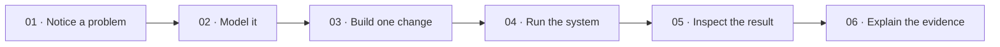

<!-- The Singularity Workshop moniker -->

# ✳️ Singularity University

**Learn the Workshop by living in the problem.**

The Learning Center is a browser-based university prototype set inside the vision of Singularity City. Explore the city map, step into a campus based on WebPage's own campus catalog, see the day unfold, and enroll in short problem-solving courses.

🧭 **[Enter Singularity University →](https://trentbest.github.io/TheSingularityWorkshop.Learning/)**

## Start with a problem

Each course asks you to do something concrete: give meaning to a click, build a scene from a model, compose a capability, hear a reflected path, design a learner activity, or diagnose a mismatch. Course cards point to the relevant Workshop repositories and current learning guides for deeper reading.

Enrollment is a same-browser session demonstration. It becomes a semantic intent that the FSM_UserIO-powered FSM_API showcase reads when it opens. It does not create a persistent student account or registration.

## A living campus, with clear evidence

GitHub Pages checks out the WebPage development branch and generates city and campus SVG maps through TheSingularityWorkshop.Visualize from `SingularityCityCatalog` and `SingularityCampusCatalog`. The city catalog describes University Quarter as future; the Learning Center presents an educational campus prototype based on the source catalog, not as an already-composed Singularity City runtime.

The moving campus activity feed and schedule are local presentation simulations. For implementation status, source links, and the boundary between catalog concepts and running systems, see the [University experience notes](docs/SINGULARITY_UNIVERSITY.md).

## Learn by solving

This is the learning progression used by the center, not a claim about the architecture of a Workshop runtime.

## Enter a real lab

🧪 **[Launch the FSM_API + FSM_UserIO Behavior Lab →](https://trentbest.github.io/TheSingularityWorkshop.Learning/demo/)** — change agent inputs, advance a shared processing group, and inspect real state transitions. Follow the [worked problem from model to proof](docs/PROBLEM_TO_PROOF.md), browse the [technology atlas](docs/TECHNOLOGY_ATLAS.md), or explore the [Frontier Lab](https://trentbest.github.io/TheSingularityWorkshop.Learning/frontier.html).

## Standards and sources

Learning pages teach by solving a problem and link to project repositories for deeper API and implementation reading. Documentation follows the [FSM_COS documentation standard](https://github.com/TrentBest/TheSingularityWorkshop.FSM_COS/blob/master/DOCUMENTATION_STANDARD.md).

- [Learning plans](docs/plans/INDEX.md)
- [Functional map](docs/FUNCTIONAL_MAP.md)
- [Learning journey](docs/LEARNING_JOURNEY.md)
- [FSM_API source](https://github.com/TrentBest/FSM_API)
- [FSM_UserIO source](https://github.com/TrentBest/FSM_UserIO)
- [WebPage city and campus source](https://github.com/TrentBest/WebPage/tree/development)
