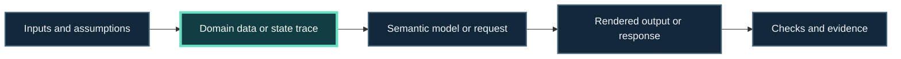

<!-- The Singularity Workshop moniker -->

# Debug a Result by Finding the First Divergence

When a result looks wrong, it is tempting to stare at the final picture or rewrite the last step. A faster route is to compare each handoff and find the **first place the actual result stops matching the expected one**.

This is a troubleshooting workflow across Workshop projects, not a new API. Use the linked repository docs for exact contracts and setup.

## Follow the result backward, then verify forward

**Diagram status:** authored diagnostic model, source-checked against the boundaries described in the linked Workshop guides. It is not an architecture diagram or runtime trace.

Read the sequence as five checkpoints:

1. **Inputs:** which parameters, configuration, request values, units, and assumptions went in?
2. **Data or behavior:** what state trace or recorded data did the owning model produce?
3. **Representation:** did the next layer build the scene, request, or host state you intended?
4. **Output:** does the renderer or service response match that representation?
5. **Evidence:** which check establishes the expected result, and for which version?

Start at the visible failure and compare each checkpoint with its upstream input. The first mismatch is usually the most useful debugging target.

## Pick the symptom that matches yours

| What you observe | Compare first | Project or boundary to inspect |
|---|---|---|
| State values or transitions are wrong | Initial state, transition conditions, update/tick order, and actual trace | [FSM_API](https://github.com/TrentBest/FSM_API) and the host loop |
| A run record has unexpected values, units, or frame | Model configuration and recorded schema, units, and coordinate frame | [Physics](https://github.com/TrentBest/TheSingularityWorkshop.Physics) |
| Values are correct, but the semantic scene is wrong | The values supplied to each node, child relationship, and GUI property | GUI Core and the sample that constructs the scene |
| The semantic scene is correct, but SVG is wrong | Node-to-element mapping, properties, escaping, and output structure | [GUI.SVG adapter](https://github.com/TrentBest/TheSingularityWorkshop.GUI/blob/development/docs/SVG_ADAPTER.md) |
| A request was built or interpreted incorrectly | Operation descriptor, bound values, transport result, and application mapping | [REST walkthrough](REST_CAPABILITY.md) and [FSM_REST](https://github.com/TrentBest/TheSingularityWorkshop.FSM_REST) |
| The example is correct, but the host behaves differently | Which component owns the loop, clock, rendering, or input | The host's startup and implementation-status guide |

The table is a routing aid. A symptom can cross more than one boundary; follow the data until the first divergence is clear.

## Work one boundary at a time

### 1. Capture a small, repeatable case

Write down the smallest input that shows the mismatch. Include the configuration, project revision, expected result, actual result, and the command or host action that produced it. Keep the original output; changing several values at once makes the first cause harder to identify.

### 2. Compare the output of each handoff

At each step, record what entered and what left. For a stateful workflow, keep the transition trace. For a data workflow, keep the exact input record. For a visual workflow, inspect both the semantic scene and its rendered file when the example exposes them.

### 3. Stop at the first mismatch

If the state trace is already wrong, changing SVG styling will hide the symptom without correcting the behavior. If the trace and semantic scene are right but the SVG is wrong, move to the adapter boundary. Keep each fix with the project that owns that responsibility.

### 4. Recheck the boundary and one downstream result

After a correction, verify the first mismatching handoff and then one result downstream. Name the check and revision. Do not treat a static screenshot as proof of a live runtime, or a source inspection as proof that the sample ran.

## Walkthrough: a bounded value looks wrong

The [FSM-driven oscillator recipe](https://github.com/TrentBest/TheSingularityWorkshop.GUI/blob/development/samples/demonstrations/recipes/07-fsm-driven-oscillator.md) expects the step-3 sequence `3, 6, 9, 10, 7, 4, 1, 0`. Its upstream CI run asserts the trace and endpoint behavior, checks invalid configurations and SVG structure, and has a visually reviewed artifact: [run 40961583029](https://github.com/TrentBest/TheSingularityWorkshop.GUI/actions/runs/40961583029).

Use the earliest failing checkpoint:

- If the **sequence** differs, inspect the FSM's starting value, direction, step, bounds, and update sequence.
- If the **sequence is correct but plotted points are wrong**, inspect the mapping from trace values into the scene's coordinates.
- If the **scene is correct but the SVG differs**, inspect GUI.SVG's mapping and serialization.
- If the **SVG looks static**, that is expected for this recipe: its checked output is a snapshot, not a live FSM animation.

This learning center did not rerun the sample. Use the recipe's evidence and project version when reproducing its result.

## Walkthrough: a trajectory marker looks misplaced

The [record-to-trajectory lesson](TRACE_TO_TRAJECTORY.md) follows a Physics-owned JSON record into a GUI.SVG consumer. Inspect in this order:

1. Check the record's model and schema identity, units, coordinate frame, sample times, and position values.
2. Check that the consumer reads the intended axes and maps every source sample to a marker.
3. If the generated scene is right but its SVG is wrong, inspect the renderer boundary.

The consumer does not re-run Physics. A valid image proves that these recorded samples were mapped into the expected scene; it does not prove the Physics model was freshly executed.

## Leave a useful proof trail

A clear troubleshooting note contains:

- the smallest reproducible input and project revision;
- the expected and actual value at the first mismatch;
- the owning project or handoff;
- the correction made;
- the check or artifact that confirms the correction.

### Evidence status

- **Diagnostic flow:** authored, source-checked model of the boundaries linked above.
- **Oscillator evidence:** upstream CI-verified and artifact-reviewed at the linked run; not rerun by this guide.
- **Trajectory evidence:** follow the linked recipe for its source record, consumer checks, and current CI evidence.

<!-- THE SINGULARITY WORKSHOP FOOTER -->

