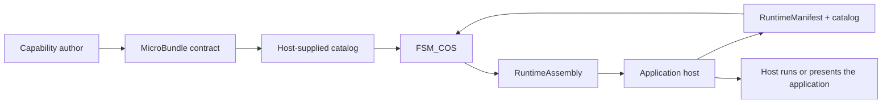

<!-- The Singularity Workshop moniker -->

# Functional Map

This page groups projects by the job a learner may want to do. It is an orientation map, not a copy of project documentation, a dependency graph, or a claim that every project in a group is already integrated with the others.

For a practical route, see [Learning Paths](LEARNING_PATHS.md). For full implementation details, follow each project link.

## The composition loop

The clearest documented Workshop workflow begins with a host requesting a composition:

**Diagram status:** authored, source-checked orientation diagram. It summarizes the boundary documented in FSM_COS's [learning guide](https://github.com/TrentBest/TheSingularityWorkshop.FSM_COS/blob/master/docs/LEARNING_GUIDE.md). It is not a runtime trace or a complete dependency map of the Workshop. The host supplies the manifest and catalog. FSM_COS resolves and validates the reachable MicroBundle dependencies, loads prerequisites first, arbitrates within its configured bound, and returns a RuntimeAssembly. The host owns what happens after handoff.

## Find a project by the job you want to do

### Control stateful behavior

Use these when you want to define behavior as named states and transitions, then connect that behavior to an application's update cycle or input surface.

- [FSM_API](https://github.com/TrentBest/FSM_API) — state-machine foundations for C# applications.
- [FSM_API_Unity](https://github.com/TrentBest/FSM_API_Unity) — Unity integration for FSM_API.
- [FSM_UserIO](https://github.com/TrentBest/FSM_UserIO) — user I/O in the FSM ecosystem.

### Define and compose capabilities

Use these when you want to describe reusable capabilities, request a set of them, and let a composition boundary resolve their declared prerequisites.

- [MicroBundleDomain](https://github.com/TrentBest/TheSingularityWorkshop.MicroBundleDomain) — the MicroBundle contracts consumed by FSM_COS.
- [FSM_COS](https://github.com/TrentBest/TheSingularityWorkshop.FSM_COS) — resolve, validate, and compose the requested dependency closure; return a RuntimeAssembly.
- [MicroBundleRepository](https://github.com/TrentBest/TheSingularityWorkshop.MicroBundleRepository) — durable artifact boundary for MicroBundles.
- [MicroBundleIngestor](https://github.com/TrentBest/TheSingularityWorkshop.MicroBundleIngestor) — start here when your workflow involves ingesting bundles.

### Describe and connect services

Use these when you want to separate a reusable operation description from a particular request and its runtime response.

- [FSM_REST](https://github.com/TrentBest/TheSingularityWorkshop.FSM_REST) — neutral REST capability descriptions and transport contracts.
- [FSM_Serialization](https://github.com/TrentBest/TheSingularityWorkshop.FSM_Serialization) — serialization concerns for FSM ecosystem data.

### Structure AI-facing meaning and behavior

These projects concern different layers of AI-adjacent application work; their names do not imply that they contain a model or inference engine.

- [ProtocolAi](https://github.com/TrentBest/TheSingularityWorkshop.ProtocolAi) — application-owned meaning with a deterministic address space; no model/inference engine or provider transport is included, according to its README.
- [GrammarAi](https://github.com/TrentBest/TheSingularityWorkshop.GrammarAi) — structure for connecting those application-owned identities.
- [HeadlessAi](https://github.com/TrentBest/TheSingularityWorkshop.HeadlessAi) — headless input-to-response connection to a configured AI-capable HTTP endpoint, per its README.
- [CommandAi](https://github.com/TrentBest/TheSingularityWorkshop.CommandAi) and [CiAi](https://github.com/TrentBest/TheSingularityWorkshop.CiAi) — related projects; check their current repository documentation for exact scope and usage.

### Author and present Experiences

Learn to distinguish authored Experiences from the hosts and surfaces that manifest them.

- [Experiences](https://github.com/TrentBest/TheSingularityWorkshop.Experiences) — independently authored Experience and MicroBundle artifacts.
- [AnyApp](https://github.com/TrentBest/AnyApp) — desktop composition host.
- [WebApp](https://github.com/TrentBest/TheSingularityWorkshop.WebApp), [WebPage](https://github.com/TrentBest/WebPage), and [GUI](https://github.com/TrentBest/TheSingularityWorkshop.GUI) — browser and user-interface projects.
- [MyVR](https://github.com/TrentBest/TheSingularityWorkshop.MyVR) — VR-facing project.

These are separate projects with distinct responsibilities; the list is a set of starting points, not proof that every manifestation is ready or connected in a single working pipeline.

### Model worlds and interaction

Find projects that focus on the meaning of a world, physical behavior, visual output, or user input.

- [Ontology](https://github.com/TrentBest/TheSingularityWorkshop.Ontology) — define, version, index, address, and relate ontological information.
- [Physics](https://github.com/TrentBest/TheSingularityWorkshop.Physics) — physical modeling project.
- [Renderer](https://github.com/TrentBest/TheSingularityWorkshop.Renderer) and [Visualize](https://github.com/TrentBest/TheSingularityWorkshop.Visualize) — rendering and image-producing work.
- [Gestures](https://github.com/TrentBest/TheSingularityWorkshop.Gestures) and [FSM_UserIO](https://github.com/TrentBest/FSM_UserIO) — input and interaction starting points.
- [StoryBuilder](https://github.com/TrentBest/StoryBuilder) — author an Experience or Tool design record and compose its narrative material.

### Work with identity and creator systems

- [Profiles](https://github.com/TrentBest/TheSingularityWorkshop.Profiles) — observer-specific representations of an entity.
- [Economy](https://github.com/TrentBest/TheSingularityWorkshop.Economy)
- [CreatorNetwork](https://github.com/TrentBest/TheSingularityWorkshop.CreatorNetwork)
- [Foundry](https://github.com/TrentBest/TheSingularityWorkshop.Foundry)
- [DataWarehouse](https://github.com/TrentBest/TheSingularityWorkshop.DataWarehouse)

For the last four projects, use their current repository README as the authority for scope. This map includes them as part of the Workshop's public project landscape without inventing feature claims from their names.

## How to read the map

- A project name is a doorway, not a lesson. Follow the path that matches your task.
- The project's README and linked guides own exact setup, API, status, and limitations.
- A conceptual path between projects is not proof of a working integration.
- Treat examples as **Verified** only when a named revision was actually built/run; use **Source-checked** for code inspected but not executed; label diagrams **Conceptual** when they illustrate a possible design rather than sourced behavior.

## Sources and scope

Project descriptions and the FSM_COS composition loop were checked against public repository documentation on 2026-10-30. This is a selected, learner-relevant map, not an inventory of every repository owned by The Singularity Workshop. Recheck each linked project before relying on current behavior.
