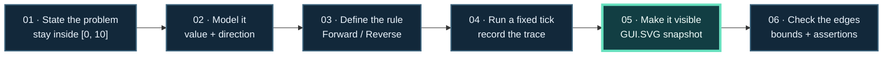

<!-- The Singularity Workshop moniker -->
<p align="center"><a href="https://github.com/TrentBest"></a></p>

# From Problem to Proof: Keep Motion Inside a Safe Range

A useful learning path begins with a problem someone can recognize, then shows how the technology models it, solves it, and makes the result observable.

## The problem

A value moves between a minimum and maximum. When it reaches either endpoint, it must turn around. It must not wrap to the other side or escape the allowed range.

This is a small problem with meaningful edges: ordinary steps, exact endpoints, a step larger than the whole range, and invalid settings.

## Follow the solution



**Diagram status:** authored teaching model, source-checked against the oscillator recipe; it is not a runtime trace. The tick table below is the recipe's documented expected behavior.

The highlighted step is where a hidden state becomes something people can inspect. In the worked sample, the SVG is generated from the final FSM context; it is a snapshot of computed data, not the thing that computes or advances that data.

## 1. Model the changing facts

Use a minimum of `0`, maximum of `10`, and step size of `3`. The state machine needs to remember the current value and whether it is moving forward or in reverse.

The FSM states name the behavior. The context holds the changing value. The host supplies each update tick.

## 2. Make the rule explicit

- In **Forward**, add the step.
- If that would pass the maximum, clamp at the maximum and switch to **Reverse**.
- In **Reverse**, subtract the step.
- If that would pass the minimum, clamp at the minimum and switch to **Forward**.

With a step size of 3, the trace is:

| Tick | State action | Value |
|---:|---|---:|
| 1 | Move forward | 3 |
| 2 | Move forward | 6 |
| 3 | Move forward | 9 |
| 4 | Clamp at maximum; reverse | 10 |
| 5 | Move in reverse | 7 |
| 6 | Move in reverse | 4 |
| 7 | Move in reverse | 1 |
| 8 | Clamp at minimum; move forward | 0 |

The sequence `3, 6, 9, 10, 7, 4, 1, 0` makes the endpoint behavior visible. It is also easy to compare with an expected trace.

## 3. Render the computed result

The sample uses **FSM_API** for state transitions, **GUI.Core** to build a semantic scene, and **GUI.SVG** to serialize the scene as a vector document. The curve is `y = sin(x)`; its marker comes from the final value held by the FSM context.

[](https://github.com/TrentBest/TheSingularityWorkshop.GUI/blob/development/samples/FoxSheepdogPlane/Program.cs)

*This separate GUI.SVG scene makes a repeated grid problem vivid. Its fox routes and jumps are authored SVG animation, not a live FSM_API trace. The worked oscillator below is the example that connects actual FSM state to the generated picture.*

## 4. Run the worked sample

Use the [FSM-driven bounded oscillator recipe](https://github.com/TrentBest/TheSingularityWorkshop.GUI/blob/development/samples/demonstrations/recipes/07-fsm-driven-oscillator.md) in the GUI repository's `development` branch. From that repository's root:

```sh
dotnet run --project samples/demonstrations/FsmDrivenOscillator/FsmDrivenOscillator.csproj
```

The sample prints its trace and writes `07-fsm-driven-oscillator.generated.svg` by default. The recipe records the exact state transitions, endpoint behavior, and how the scene is rendered. It also links to the [CI run and its generated artifacts](https://github.com/TrentBest/TheSingularityWorkshop.GUI/actions/runs/40961583029).

**Evidence:** the GUI repository's recipe labels this sample CI-verified and artifact-reviewed on commit `dce2b360f45ff268d156b162f162c252a3ccc748`. The source recipe says its executable checks the transition trace, oversized steps, invalid configuration, and generated SVG structure. The SVG is a static snapshot, not a live animation.

## 5. Change one thing and predict the result

Before editing the sample, write down what should happen.

- **Use a step larger than the range.** The value should clamp at an endpoint and reverse; it should not wrap.
- **Set equal minimum and maximum.** The sample should reject the invalid range.
- **Change the function but keep the state rules.** The movement trace should remain the same while the plotted curve changes.
- **Change the FSM rule.** Update the expected trace and the checks that establish the new behavior.

Then run the sample and compare your prediction with its trace and generated SVG.

## What this lesson teaches

The important progression is not “read a repository, then read another repository.” It is:

1. State a human problem and its boundaries.
2. Name the information that changes.
3. Express behavior as rules and states.
4. Run the behavior and retain an observable trace.
5. Render the result without making the renderer the source of truth.
6. Check ordinary cases and edge cases against explicit expectations.

That pattern can guide the other [learning paths](LEARNING_PATHS.md). For exact APIs and limitations, return to the [FSM_API](https://github.com/TrentBest/FSM_API), [GUI.SVG adapter contract](https://github.com/TrentBest/TheSingularityWorkshop.GUI/blob/development/docs/SVG_ADAPTER.md), and [GUI implementation status](https://github.com/TrentBest/TheSingularityWorkshop.GUI/blob/development/docs/IMPLEMENTATION_STATUS.md).

<!-- THE SINGULARITY WORKSHOP FOOTER -->
<p align="center"></p>
