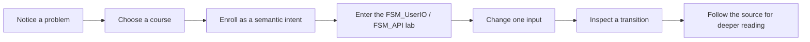

# Singularity University: experience and evidence

## Purpose

Singularity University is the Learning Center's campus metaphor for learning The Singularity Workshop by solving a problem. It is located within the larger Singularity City vision described by the WebPage project.

A visitor should be able to orient quickly, choose a learning plan, try an interaction, and follow source links for deeper implementation reading. Campus activity is a spark of inspiration, not a forced tour.

## A learner's route

A course card describes a problem, the place where the work happens, an approximate lesson duration, and links to a guided lesson or source repository. The six initial learning routes cover behavior and interaction, visual systems, composition, Physics and sound, learning experiences, and debugging evidence.

## City and campus source

The Pages workflow checks out WebPage's `development` branch. It runs `tools/CampusVisualize` against these source files:

- `TheSingularityWorkshop/Workshop/Spatial/SingularityCityCatalog.cs`
- `TheSingularityWorkshop/Workshop/Spatial/SingularityCampusCatalog.cs`

The tool parses catalog IDs, names, positions, sizes, and available style hints, then uses TheSingularityWorkshop.Visualize's SVG backend to produce `data/city-map.svg` and `data/campus-map.svg`. It also emits JSON so the browser can label the number of catalog places. The University Quarter is highlighted at city scale; the campus map is derived from the actual campus-place catalog rather than a separately invented list.

## The boundary between source and experience

The WebPage catalog currently marks `city-university` / University Quarter as a future district. This Learning Center is a browser-based educational prototype inspired by those cataloged places. It does not claim that the entire Singularity City runtime or a finished university has been composed and deployed.

The campus activity feed and day-advance control are a local presentation simulation. The displayed learner moments are authored prompts, not observations of real users or a live crowd simulation. The maps are generated from source catalog data at build time.

The existing Education page in WebPage describes shared lessons, lesson blocks, teacher overlays, learner workspaces, and question/recognition flows. Those are useful learning-design patterns. They should be cited as concepts from that host, not represented as capabilities of this static Pages prototype.

## FSM_UserIO interaction boundary

Campus actions write small `SemanticIntent`-shaped records into same-tab `sessionStorage` under `tsw.fsm-userio.trace.v1`. Course confirmation emits `Course.Enroll.<course-id>`, then opens the Blazor FSM_API showcase. The showcase deserializes the trail into `SemanticIntent` instances and presents accepted course choices alongside the live FSM lab.

This demonstrates an intent crossing from browser interaction into a .NET host that uses FSM_UserIO and FSM_API. The browser session is temporary; there is no account, server-side enrollment, durable course progress, or network submission.

## Course design contract

Each course should follow the FSM_COS documentation standard and make these pieces visible:

1. **Problem:** a specific outcome the learner wants.
2. **Starting state:** the inputs and assumptions.
3. **Workshop path:** which package owns each step and why.
4. **Try it:** an action the learner can perform.
5. **Observe:** the expected state, image, data, or sound.
6. **Checkpoint:** what the result demonstrates and what remains unproven.
7. **Go deeper:** direct links to authoritative repository documentation and source.

Keep repository links as deeper reading, not as a substitute for the guided lesson. Prefer one clear action per section, short explanations beside the visual, keyboard-accessible controls, and reduced-motion support.

## Next experiments

- Replace authored activity moments with deterministic, source-grounded campus simulation when the required runtime can be composed in Pages.
- Give each course a dedicated lesson page that lets a learner run or inspect the promised outcome.
- Keep tracking what comes from a source catalog, what is generated in CI, what is simulated locally, and what is a future direction.
