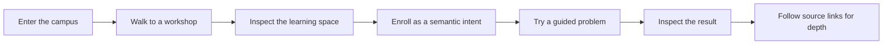

<!-- The Singularity Workshop moniker -->

# Singularity University: experience and evidence

## Purpose

Singularity University is the Learning Center's campus metaphor for learning The Singularity Workshop by solving a problem. It is located within the larger Singularity City vision described by the WebPage project.

The Pages home opens directly into a full-screen first-person walk. The learner moves with WASD and mouse look, inspects a building in-world, chooses a course there, and can open an optional campus map without leaving the scene. Source links remain available from a course when the learner wants deeper implementation reading.

## A learner's route

A course card describes a problem, the place where the work happens, an approximate lesson duration, and links to a guided lesson or source repository. The six initial learning routes cover behavior and interaction, visual systems, composition, Physics and sound, learning experiences, and debugging evidence.

## City and campus source

The Pages workflow checks out WebPage's `development` branch. It runs `tools/CampusVisualize` against these source files:

- `TheSingularityWorkshop/Workshop/Spatial/SingularityCityCatalog.cs`
- `TheSingularityWorkshop/Workshop/Spatial/SingularityCampusCatalog.cs`

The tool parses catalog IDs, names, positions, sizes, and style hints, then uses Visualize's SVG backend to produce city and campus map artifacts plus JSON. These are used for the optional orientation map and as source-backed layout input.

The main experience is different: the Blazor WebAssembly host loads the generated campus catalog, creates one indexed low-poly mesh through Visualize resource contracts, and submits first-person VisualizerFrames through Visualizer.RenderAsync. The campus host implements Visualize's IVisualizerBackend using the browser's WebGPU API: the mesh is uploaded into GPU buffers by resource revision, while camera and projection data update per frame. The WebGPU pipeline performs indexed drawing with a depth buffer and directional vertex lighting. It does not use Three.js or another scene engine.

This is an executable GPU backend proof connected to Visualize's public frame/resource/backend contracts. Its current scope is intentionally small: one campus mesh and camera. The Learning Center adapter and WebGPU shader now implement instance-data serialization, revision-based storage-buffer caching, and indexed instanced draw submission using Visualize's instance-resource/count/first-instance fields. The backend still reports `supportsInstancing: false`: the campus scene now exercises a reusable tree mesh with eighteen instance records, while focused adapter/cache tests and browser/device runtime capture remain validation gates. GPU compute, indirect drawing, GPU timer queries, device-loss recovery, and live Renderer horizon scheduling are not implemented. CI compiles the WebAssembly host; this alone does not certify runtime support on a particular browser/device or establish a performance result. The host requires browser WebGPU over HTTPS and reports an explicit message if WebGPU cannot initialize; it does not silently fall back to SVG.

## The boundary between source and experience

The WebPage catalog currently marks `city-university` / University Quarter as a future district. This Learning Center is a browser-based educational prototype inspired by those cataloged places. It does not claim that the entire Singularity City runtime or a finished university has been composed and deployed.

The campus catalog layout and named places come from WebPage. Student movement and ambient campus prompts are a local deterministic presentation simulation, not observations of real users or a live crowd simulation. The WebGPU campus renderer depth-tests its low-poly surfaces. The optional map remains a generated SVG artifact.

The existing Education page in WebPage describes shared lessons, lesson blocks, teacher overlays, learner workspaces, and question/recognition flows. Those are useful learning-design patterns. They should be cited as concepts from that host, not represented as capabilities of this static Pages prototype.

## FSM_UserIO interaction boundary

First-person campus actions create `SemanticIntent` values and record them into same-tab `sessionStorage` under `tsw.fsm-userio.trace.v1`. Inspecting a learning space and enrolling emit semantic action names; the host validates supported course IDs. Enrollment choices appear in the FSM_API showcase when opened from a course door.

This demonstrates input crossing from browser controls through FSM_UserIO into the .NET host, while Visualize renders the changing first-person camera frames. The browser session is temporary; there is no account, server-side enrollment, durable course progress, or network submission.

## Course design contract

Each course should follow the FSM_COS documentation standard and make these pieces visible:

1. **Problem:** a specific outcome the learner wants.
2. **Starting state:** the inputs and assumptions.
3. **Workshop path:** which package owns each step and why.
4. **Try it:** an action the learner can perform.
5. **Observe:** the expected state, image, data, or sound.
6. **Checkpoint:** what the result demonstrates and what remains unproven.
7. **Go deeper:** direct links to authoritative repository documentation and source.

Keep repository links as deeper reading, not as a substitute for the guided lesson. Prefer one clear action per section, short explanations beside the visual, keyboard-accessible controls, and reduced-motion support.

## Next experiments

- Replace the presentation-layer student loops with WebPage's composed city/education runtime when its host can be safely run in Pages.
- Give each course a dedicated lesson page that lets a learner run or inspect the promised outcome.
- Keep tracking what comes from a source catalog, what is generated in CI, what is simulated locally, and what is a future direction.

<!-- THE SINGULARITY WORKSHOP FOOTER -->

