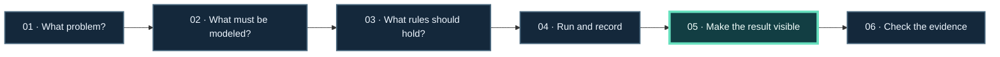

<!-- The Singularity Workshop moniker -->

# Start Here: Learn by Solving a Problem

Pick a challenge, follow the data and behavior that solve it, then inspect the visible result. The projects are useful because they help with those steps; you do not need to memorize their names before you begin.

🧭 Want to explore visually first? [Open the interactive learning explorer](https://trentbest.github.io/TheSingularityWorkshop.Learning/site/). It includes a small adjustable model and links back to each problem guide.

## See a scene

*This lively scene is generated by the GUI.SVG sample. Its fox movement is authored as SVG animation; the current example is not a live FSM_API trace.*

## Your learning progression

**Diagram status:** authored teaching framework; it shows how this center structures a lesson, not an observed execution trace.

See the [Learning Journey](LEARNING_JOURNEY.md) for the recommended progression across examples. The first full walkthrough is [Keep Motion Inside a Safe Range](PROBLEM_TO_PROOF.md). It uses the FSM-driven bounded oscillator: an FSM controls the value, the sample records its behavior, and GUI.SVG renders a static picture of the computed result.

## Choose the challenge closest to yours

- **Make behavior change in a controlled way.** Start with the [state-machine path](LEARNING_PATHS.md#control-behavior-with-state-machines).
- **Request a capability and its prerequisites.** Start with the [composition path](LEARNING_PATHS.md#compose-capabilities-into-a-runtime).
- **Describe and send an API operation.** Start with the [REST path](LEARNING_PATHS.md#describe-and-send-a-rest-capability).
- **Make a picture from actual simulation output.** Follow the [run-record-to-trajectory lesson](TRACE_TO_TRAJECTORY.md).
- **Build an authored experience and choose how to present it.** Start with the [Experience path](LEARNING_PATHS.md#author-and-present-an-experience).
- **Understand how meaning, motion, visuals, and input fit together.** Start with the [world and interaction path](LEARNING_PATHS.md#model-render-and-interact).

Not sure which projects are relevant? Use the [functional map](FUNCTIONAL_MAP.md). Need a term clarified? Use the [shared vocabulary](GLOSSARY.md).

## What to read after the first example

Follow the [FSM-driven oscillator recipe](https://github.com/TrentBest/TheSingularityWorkshop.GUI/blob/development/samples/demonstrations/recipes/07-fsm-driven-oscillator.md) for its state diagram, checks, and boundaries. The GUI repository also documents [what GUI.SVG does](https://github.com/TrentBest/TheSingularityWorkshop.GUI/blob/development/docs/SVG_ADAPTER.md) and [what is implemented today](https://github.com/TrentBest/TheSingularityWorkshop.GUI/blob/development/docs/IMPLEMENTATION_STATUS.md).

The GUI.SVG renderer converts a semantic `GuiNode` snapshot into SVG. It does not run the FSM, own an animation clock, or make the output interactive. The learning path keeps those responsibilities visible instead of letting the picture imply more than the code proves.
