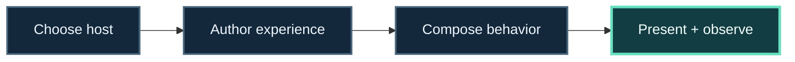

<!-- The Singularity Workshop moniker -->

# Build a browser or desktop experience

> **Mission:** create an application surface that can host changing behavior without letting the interface become the whole system.

**Route:** choose the host → compose behavior → build the presentation → trace what the user sees.

This map keeps the authored work and the host that presents it visible as separate steps.

**Progress map:** Choose host → Author experience → Compose behavior → Present + observe

## Your route

1. **Start with the user outcome.** Decide whether you are shaping a browser app, a desktop app, or a portable authored Experience.
2. **Inspect the host.** The [WebPage repository](https://github.com/TrentBest/WebPage) is the Workshop’s browser-facing proving ground. The [WebApp repository](https://github.com/TrentBest/TheSingularityWorkshop.WebApp) is a separate project marker; follow its own current documentation before treating it as a runnable host.
3. **Keep authored content portable.** Explore [Experiences](https://github.com/TrentBest/TheSingularityWorkshop.Experiences) for the boundary between an Experience artifact and the application that presents it.
4. **Make the surface legible.** Use [GUI](https://github.com/TrentBest/TheSingularityWorkshop.GUI) to explore semantic GUI models and the available presentation adapters.
5. **Compose where useful.** Follow [FSM_COS](https://github.com/TrentBest/TheSingularityWorkshop.FSM_COS) when the host needs a requested set of reusable capabilities with declared dependencies.

## Checkpoints

- Which project owns startup, navigation, and user session?
- Which parts are authored content, capability, or host?
- What can be changed without rewriting the Experience?

## Project map

[WebPage](https://github.com/TrentBest/WebPage) · [WebApp](https://github.com/TrentBest/TheSingularityWorkshop.WebApp) · [Experiences](https://github.com/TrentBest/TheSingularityWorkshop.Experiences) · [GUI](https://github.com/TrentBest/TheSingularityWorkshop.GUI) · [FSM_COS](https://github.com/TrentBest/TheSingularityWorkshop.FSM_COS) · [AnyApp](https://github.com/TrentBest/AnyApp) · [MyVR](https://github.com/TrentBest/TheSingularityWorkshop.MyVR)

**Good fit:** application work where host lifecycle and authored content should remain distinct.  
**Plan boundary:** WebPage and WebApp are separate repositories; use each repository’s current entry points and status as the source of truth.

**Next:** [Explore Experiences and hosts](../technologies/EXPERIENCES_AND_HOSTS.md) · [browse all application plans](../INDEX.md#choose-by-what-youre-building)

<!-- THE SINGULARITY WORKSHOP FOOTER -->

