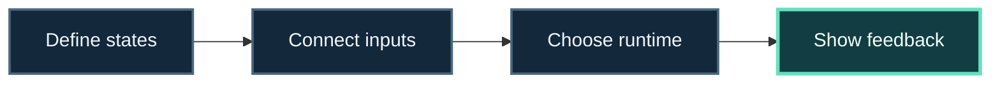

# Build an interactive system

> **Mission:** make a game, simulation, or responsive tool whose behavior stays understandable as inputs and modes multiply.

**Route:** define the behavior → connect inputs → present the state → inspect the result.

This map follows the path of one interaction, from an explicit behavior model to observable feedback.

**Progress map:** Define states → Connect inputs → Choose runtime → Show feedback

## Your route

🧪 **[Operate the FSM_API Behavior Lab →](https://trentbest.github.io/TheSingularityWorkshop.Learning/demo/)**. Change one agent’s context, advance the processing group, and inspect its transitions before following the implementation links below.

1. **Name the modes.** Start with a small state vocabulary and the conditions that change it. Work through the [FSM_API quickstart](https://github.com/TrentBest/FSM_API).
2. **Connect a person to the model.** Explore [FSM_UserIO](https://github.com/TrentBest/FSM_UserIO) for the FSM input/output layer. If the experience depends on motion or gesture, inspect [Gestures](https://github.com/TrentBest/TheSingularityWorkshop.Gestures).
3. **Choose the runtime.** For Unity, follow [FSM_API_Unity](https://github.com/TrentBest/FSM_API_Unity); for a browser host, compare [WebPage](https://github.com/TrentBest/WebPage) and [GUI](https://github.com/TrentBest/TheSingularityWorkshop.GUI).
4. **Make the behavior observable.** Follow the [bounded-motion walkthrough](../PROBLEM_TO_PROOF.md), then compare its GUI scene and SVG snapshot with the [worked recipe](https://github.com/TrentBest/TheSingularityWorkshop.GUI/blob/development/samples/demonstrations/recipes/07-fsm-driven-oscillator.md).

## Checkpoints

- Can you list the states and the trigger for every transition?
- Can you replay an input and predict the resulting state?
- Can you tell which layer owns behavior, input, and presentation?

## Project map

[FSM_API](https://github.com/TrentBest/FSM_API) · [FSM_API_Unity](https://github.com/TrentBest/FSM_API_Unity) · [FSM_UserIO](https://github.com/TrentBest/FSM_UserIO) · [Gestures](https://github.com/TrentBest/TheSingularityWorkshop.Gestures) · [GUI](https://github.com/TrentBest/TheSingularityWorkshop.GUI) · [Physics](https://github.com/TrentBest/TheSingularityWorkshop.Physics)

**Good fit:** interactive behavior with explicit modes, inputs, and observable outcomes.  
**Plan boundary:** these projects have distinct roles and versions; this route is a learning sequence, not a promise that every integration is already packaged together.

**Next:** [Learn state machines and input as technologies](../technologies/STATE_AND_INTERACTION.md) · [browse all application plans](../INDEX.md#choose-by-what-youre-building)
