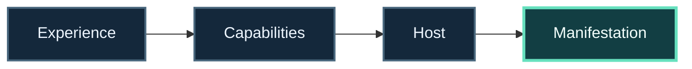

<!-- The Singularity Workshop moniker -->

# Technology path: Experiences and application hosts

**Question:** what is being authored, and what is responsible for presenting or running it?

## Learning progression

`Authored Experience → declared capabilities → selected host → platform manifestation`

The Experience is authored content; the host owns execution and manifestation.

**Progress map:** Experience → Capabilities → Host → Manifestation

1. Begin with [Experiences](https://github.com/TrentBest/TheSingularityWorkshop.Experiences): inspect how Experience artifacts remain separate from their hosts.
2. Compare the [WebPage proving ground](https://github.com/TrentBest/WebPage), the [WebApp project](https://github.com/TrentBest/TheSingularityWorkshop.WebApp), [AnyApp](https://github.com/TrentBest/AnyApp), and [MyVR](https://github.com/TrentBest/TheSingularityWorkshop.MyVR) through their current documentation.
3. Use [GUI](https://github.com/TrentBest/TheSingularityWorkshop.GUI) to explore visual presentation concerns.
4. Follow [FSM_COS](https://github.com/TrentBest/TheSingularityWorkshop.FSM_COS) when the host requests a composed runtime capability set.
5. Sketch the ownership boundary: authoring, catalog/configuration, lifecycle, execution, rendering, and publication.

### Check your understanding

Could the same authored Experience be presented by more than one host without transferring host responsibilities into the artifact?

### Choose a deeper route

- [Browser and desktop application plan](../applications/BROWSER_AND_DESKTOP.md)
- [Composed-capability application plan](../applications/COMPOSED_CAPABILITY_APP.md)
- [Experiences](https://github.com/TrentBest/TheSingularityWorkshop.Experiences)

**Scope:** a host is not interchangeable with an Experience artifact. Verify each host’s actual runtime support and deployment path before planning integration.

<!-- THE SINGULARITY WORKSHOP FOOTER -->

