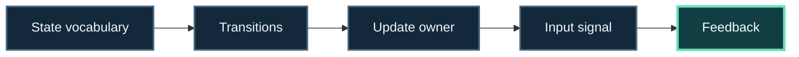

# Technology path: state and interaction

**Question:** how do I make behavior predictable and connect it to user input?

## Learning progression

🧪 **[Open the live FSM_API Behavior Lab →](https://trentbest.github.io/TheSingularityWorkshop.Learning/demo/)** — use target detection, distance, and health signals to drive three real FSM_API instances through one shared definition.

## Learning progression

`State vocabulary → transitions → update owner → input signal → visible feedback`

This progression separates the behavior model from the input and presentation boundaries.

**Progress map:** State vocabulary → Transitions → Update owner → Input signal → Feedback

1. Start with [FSM_API](https://github.com/TrentBest/FSM_API): define a small set of states, transition conditions, and context.
2. Trace who calls update and how the host owns the run loop.
3. Add [FSM_UserIO](https://github.com/TrentBest/FSM_UserIO) when the FSM input/output boundary is part of your problem.
4. For Unity, explore [FSM_API_Unity](https://github.com/TrentBest/FSM_API_Unity); for gesture-led interactions, inspect [Gestures](https://github.com/TrentBest/TheSingularityWorkshop.Gestures).
5. Use the [bounded-motion exercise](../../PROBLEM_TO_PROOF.md) to practice prediction and verification.

### Check your understanding

Explain one observed transition in this form: **starting state + triggering condition → resulting state + changed context**.

### Choose a deeper route

- [Interactive systems application plan](../applications/INTERACTIVE_SYSTEMS.md)
- [FSM_API source and usage](https://github.com/TrentBest/FSM_API)
- [FSM_UserIO](https://github.com/TrentBest/FSM_UserIO)
- [FSM_API_Unity](https://github.com/TrentBest/FSM_API_Unity)

**Scope:** this path teaches behavior and interaction ownership. It does not assume that input adapters or Unity components are present in every host.
