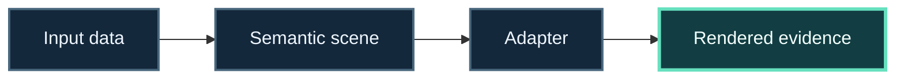

<!-- The Singularity Workshop moniker -->

# Technology path: GUI, rendering, and visual output

**Question:** how do I turn meaning or computed data into something a person can inspect?

## Learning progression

`Input data → semantic scene → presentation adapter → rendered evidence`

Follow an observable value from its source to the final presentation.

**Progress map:** Input data → Semantic scene → Adapter → Rendered evidence

1. Explore [GUI](https://github.com/TrentBest/TheSingularityWorkshop.GUI) as the Workshop GUI project; distinguish the scene model from its output adapters.
2. Follow the [GUI.SVG adapter guide](https://github.com/TrentBest/TheSingularityWorkshop.GUI/blob/development/docs/SVG_ADAPTER.md) and the [animated sample scene](https://github.com/TrentBest/TheSingularityWorkshop.GUI/blob/development/samples/FoxSheepdogPlane/Program.cs).
3. Compare the [Renderer](https://github.com/TrentBest/TheSingularityWorkshop.Renderer) project, which describes an independent rendering stack, and [Visualize](https://github.com/TrentBest/TheSingularityWorkshop.Visualize), which describes image-producing scene capability.
4. Bring real evidence: follow [run record to trajectory](../../TRACE_TO_TRAJECTORY.md), and label captured traces separately from authored motion.

### Check your understanding

Can you point from a rendered mark back to its semantic node or source data?

### Choose a deeper route

- [Simulation-to-visual application plan](../applications/SIMULATION_TO_VISUAL.md)
- [GUI.SVG sample recipe](https://github.com/TrentBest/TheSingularityWorkshop.GUI/blob/development/samples/demonstrations/recipes/07-fsm-driven-oscillator.md)
- [Visual Lab](../../VISUAL_LAB.md)

**Scope:** visual output is a manifestation of data or scene semantics; a renderer does not automatically own behavior or a simulation clock.

<!-- THE SINGULARITY WORKSHOP FOOTER -->

